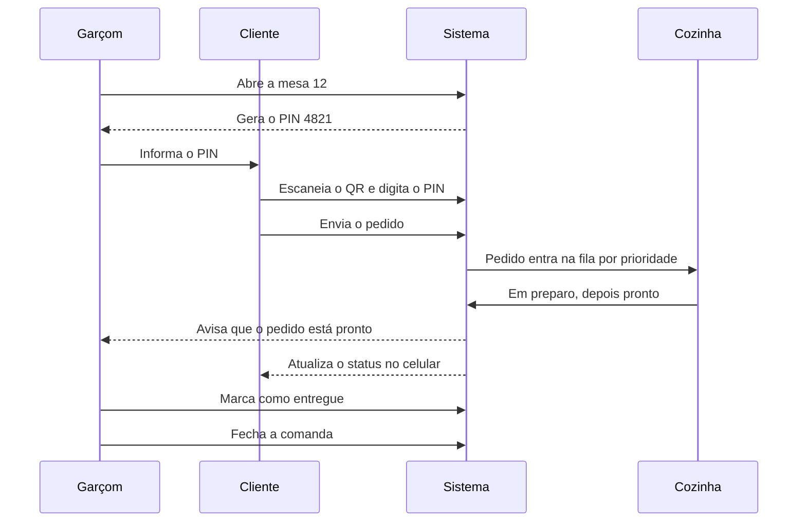
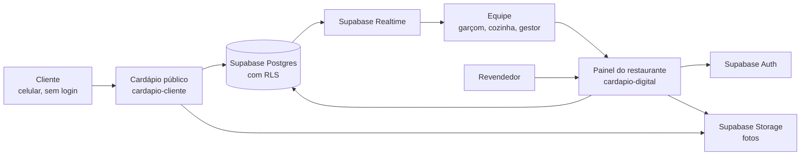

<!-- Cópia da spec original (doc no claude.ai: https://claude.ai/artifact/KM3dTUAMjh1ZdTj1z6jZX7), exportada em 2026-10-09 (rev 13). Se o doc for atualizado, re-sincronize este arquivo. -->

# Spec — Cardápio Digital com Pedido por Mesa

2026-10-09 · @Jokers

Atualização autorizada em 2026-10-10: dois projetos publicados (painel e cardápio público), personalização de cores por restaurante, gestor e cozinha priorizados para desktop. O usuário confirmou um PIN por comanda aberta, aceitando vários pedidos até o fechamento. Essas decisões prevalecem sobre os prompts originais abaixo.

Sistema white label de cardápio digital em que o cliente pede pelo celular, direto da mesa, e o pedido chega priorizado na cozinha. Este documento traz a spec do MVP e, no final, os dois prompts: um para construir a aplicação e outro para gerar o visual no ChatGPT.

## Visão geral e papéis

O produto tira do garçom o trabalho de anotar e levar pedido: o cliente pede sozinho, a cozinha recebe a fila já ordenada e o garçom só abre a mesa, entrega e fecha. É vendido pelo revendedor com a marca dele, e cada restaurante funciona isolado dos outros.

**Objetivos do MVP**

- Cliente faz um pedido completo pelo celular em menos de 1 minuto, sem baixar app e sem cadastro.
- Só quem está na mesa consegue pedir na comanda dela (PIN).
- Cozinha vê os pedidos em tempo real, na ordem que o restaurante escolheu.
- Revendedor coloca um restaurante novo no ar sozinho, sem precisar do desenvolvedor.

| Papel | Quem é | O que faz no sistema | Onde usa |
| --- | --- | --- | --- |
| Revendedor | Felipe e equipe | Cadastra restaurantes, define a marca (white label), ativa e desativa, acompanha restaurantes ativos | Painel web, desktop |
| Gestor | Dono ou gerente do restaurante | Monta o cardápio, cadastra mesas e equipe, gera QR codes, escolhe a regra da fila da cozinha, vê relatórios | Painel web, desktop e celular |
| Garçom | Equipe do salão | Abre a mesa, passa o PIN, acompanha os pedidos da mesa, marca como entregue, fecha a comanda | Celular |
| Cozinha | Cozinheiros e copa | Vê a fila, inicia e finaliza o preparo, marca item esgotado | Tablet fixo na cozinha |
| Cliente | Quem está sentado na mesa | Lê o cardápio, digita o PIN, monta e envia o pedido, acompanha o status | Celular, pelo navegador |

## Fluxos principais

O pedido nasce no celular do cliente e só passa pelo garçom em dois momentos: quando ele abre a mesa e quando entrega o prato.



O PIN é o que impede alguém de outra mesa, ou de fora do restaurante, de pedir na comanda.

**Fluxo do cliente**

1. Escaneia o QR code da mesa e cai no cardápio já identificado com a mesa ("Mesa 12").
2. Navega pelo cardápio livremente, sem PIN.
3. Ao adicionar o primeiro item ou finalizar o pedido, o sistema pede o nome da pessoa e o PIN de 4 dígitos. Todos da mesa usam o mesmo QR e o mesmo PIN; cada um entra com o próprio nome.
4. Escolhe adicionais, quantidade e observações ("sem cebola") em cada item.
5. Revisa o carrinho e envia. Pode enviar quantos pedidos quiser na mesma comanda.
6. Acompanha o status de cada pedido: recebido, em preparo, pronto, entregue.
7. Vê a comanda da mesa separada por pessoa, com a sua parte e o total da mesa. No carrinho, pode marcar um item como "Dividir com a mesa": o valor é dividido igualmente entre quem já está na comanda.

**Fluxo do garçom**

1. Abre a mesa no celular e o sistema gera o PIN.
2. Passa o PIN ao cliente, falando ou mostrando na tela.
3. Recebe aviso quando um pedido da mesa fica pronto.
4. Marca como entregue.
5. Vê quanto cada pessoa deve e marca "pago" conforme cada uma acerta a sua parte. Fecha a comanda quando todos pagam (o sistema avisa quem ainda falta). O PIN deixa de valer na hora.
6. Se precisar, gera um PIN novo para a mesma comanda (ex.: PIN vazou).

**Fluxo da cozinha**

1. A tela mostra a fila de pedidos, já ordenada pela regra do restaurante.
2. O cozinheiro toca em "Iniciar" e o pedido vai para "Em preparo".
3. Toca em "Pronto" e o garçom é avisado.
4. Pedido que passa do tempo esperado muda de cor.
5. Item que acabou pode ser marcado como esgotado, e some do cardápio na hora.

**Fluxo do gestor**

1. Cadastra categorias, itens, fotos, preços, adicionais e tempo de preparo.
2. Cadastra as mesas e baixa os QR codes para imprimir.
3. Convida a equipe (garçons e cozinha) por e-mail ou cria acesso com código.
4. Escolhe a regra de prioridade da fila da cozinha.

**Fluxo do revendedor**

1. Cria o restaurante, define o nome, o endereço do cardápio e convida o gestor.
2. Configura a marca do revendedor (logo, cores, nome do produto), que aparece em todos os restaurantes.
3. Ativa ou desativa restaurantes e vê quantos estão ativos no mês.

## Regras de negócio

**Mesa e comanda**

- Cada mesa tem um QR code fixo, impresso uma vez. Ele aponta para um link do tipo `/{restaurante}/m/{codigo-da-mesa}`; o código é aleatório, não o número da mesa.
- No MVP, cada mesa tem no máximo uma comanda aberta.
- Comanda fechada não aceita pedidos. Com a mesa livre, o QR mostra o cardápio, sem botão de pedir, e a mensagem "Chame o garçom para abrir a mesa".

**PIN**

- 4 dígitos, gerado ao abrir a comanda, único entre as comandas abertas do restaurante.
- Depois de acertar o PIN, o celular fica liberado para aquela comanda até ela ser fechada (ou por no máximo 8 horas).
- 5 tentativas erradas bloqueiam aquele celular por 5 minutos.
- O garçom pode gerar um PIN novo. Os celulares já liberados continuam funcionando.
- A validação do PIN e o envio de pedido acontecem sempre no servidor, nunca só na tela.

**Pedido**

- Status: `recebido` → `em_preparo` → `pronto` → `entregue`. Também existe `cancelado`.
- O cliente pode cancelar só enquanto o pedido está `recebido`. Depois disso, só garçom ou gestor.
- Preço e nome do item são copiados para o pedido no momento do envio. Mudar o cardápio depois não altera pedidos antigos.
- Item esgotado não pode ser pedido. Se esgotar com o cliente no carrinho, o sistema avisa ao enviar.

**Prioridade da fila da cozinha**

O gestor escolhe uma de três regras, e pode trocar a qualquer momento:

| Regra | Como ordena | Quando faz sentido |
| --- | --- | --- |
| Ordem de chegada | Quem pediu primeiro sai primeiro | Cardápio simples, pratos com tempo parecido |
| Complexidade | Pedidos de preparo mais demorado sobem, para começar antes | Cardápio com pratos muito diferentes (grelhados e porções, por exemplo) |
| Equilibrado | Mistura tempo de espera e complexidade, com pesos ajustáveis | Padrão recomendado |

O tempo de preparo de um pedido é o maior tempo de preparo entre os seus itens, já que a cozinha prepara os itens em paralelo. Cada item do cardápio tem um tempo de preparo em minutos, cadastrado pelo gestor. Na regra Equilibrado, a pontuação é:

```latex
\text{prioridade} = p_{\text{espera}} \cdot \text{minutos esperando} + p_{\text{complexidade}} \cdot \text{tempo de preparo}
```

Com pesos padrão de 1 para cada lado. Nas três regras valem duas proteções:

- **Limite de espera:** pedido esperando mais que o limite (padrão 20 minutos) vai para o topo, para nenhum pedido ficar esquecido.
- **Fixar no topo:** a cozinha ou o gestor pode fixar um pedido manualmente.

Um pedido fica atrasado quando os minutos desde o envio passam do seu tempo de preparo + 5 minutos. Aí ele muda de cor na tela da cozinha.

## Telas

São 20 telas no MVP. As do cliente e da cozinha são as que mais pesam na percepção de qualidade, então recebem o maior cuidado visual.

| # | Papel | Tela | O que tem |
| --- | --- | --- | --- |
| 1 | Cliente | Cardápio | Capa do restaurante, "Mesa 12", busca, categorias em abas fixas no topo, destaques, cards de itens com foto e preço, barra do carrinho fixa no rodapé |
| 2 | Cliente | Detalhe do item | Foto grande, descrição, grupos de adicionais (obrigatórios e opcionais), observação, quantidade, botão "Adicionar • R$ 42,90" |
| 3 | Cliente | PIN | Teclado numérico grande, 4 caixas de dígito, texto "Peça o código ao garçom" |
| 4 | Cliente | Carrinho | Itens com adicionais, editar e remover, total, botão "Enviar pedido" |
| 5 | Cliente | Pedido enviado | Confirmação animada, tempo estimado |
| 6 | Cliente | Minha comanda | Pedidos com status em tempo real, total consumido |
| 7 | Cliente | Mesa fechada | Cardápio para consulta e aviso "Chame o garçom para abrir a mesa" |
| 8 | Garçom | Login | E-mail e senha, ou código de acesso |
| 9 | Garçom | Mapa de mesas | Grade de mesas por status (livre, ocupada, pedido pronto), contador de prontos |
| 10 | Garçom | Detalhe da mesa | PIN em destaque, gerar novo PIN, pedidos da mesa, marcar entregue, fechar comanda |
| 11 | Cozinha | Fila (KDS) | Cards de pedido em colunas ou grade, número da mesa, tempo correndo, itens e observações, botões Iniciar e Pronto, cor de atraso. Tema escuro, para tablet na horizontal |
| 12 | Cozinha | Esgotados | Lista de itens com chave liga e desliga |
| 13 | Gestor | Painel inicial | Pedidos do dia, ticket médio, mesas ocupadas, itens mais pedidos |
| 14 | Gestor | Cardápio | Categorias e itens, arrastar para ordenar, ativar e desativar |
| 15 | Gestor | Editar item | Foto, nome, descrição, preço, tempo de preparo, grupos de adicionais |
| 16 | Gestor | Mesas e QR | Lista de mesas, gerar e baixar QR codes (PDF pronto para imprimir) |
| 17 | Gestor | Equipe | Convidar e remover garçons e cozinha |
| 18 | Gestor | Configurações | Regra da fila, pesos, limite de espera, dados do restaurante, foto de capa |
| 19 | Revendedor | Restaurantes | Lista com status (ativo, inativo), criar restaurante, convidar gestor, total de ativos no mês |
| 20 | Revendedor | Marca | Nome do produto, logo, cor principal, domínio |

**Diretrizes de visual**

- Cliente: mobile-first, fotos de comida em destaque, botões grandes, fluxo de pedido em no máximo 3 toques depois do PIN.
- Cozinha: legível a 1,5 metro de distância, tema escuro, alvos de toque grandes (dedos sujos ou de luva).
- Gestor e revendedor: painel limpo e claro, focado em tarefas.
- A cor principal herda a marca do revendedor, mas o gestor pode sobrescrevê-la para seu restaurante. Nome, logo, banner e fundo do cardápio também são personalizáveis.

## Arquitetura e dados

Dois projetos Vercel usam o mesmo código Next.js e um banco Supabase: `cardapio-digital` atende a equipe e a revenda; `cardapio-cliente` atende o público por QR. `APP_SURFACE` define a superfície de cada publicação. As APIs administrativas ficam indisponíveis no projeto público; QR codes e links apontam para sua origem própria. O isolamento entre restaurantes é garantido por RLS no Postgres.



O cliente nunca fala direto com o banco: tudo que ele faz passa por rotas do servidor, que validam a sessão da comanda. A equipe recebe as atualizações em tempo real pelo Supabase Realtime.

**Stack**

- Next.js (App Router) + TypeScript + Tailwind CSS + shadcn/ui
- Supabase: Postgres, Auth (equipe e revendedor), Realtime, Storage
- Vercel para hospedagem
- Valores em centavos (inteiros), moeda BRL, fuso `America/Sao_Paulo`
- API do Claude só na fase 2 (importar cardápio por foto)

**Segurança**

- Equipe e revendedor fazem login pelo Supabase Auth. O papel vem da tabela de vínculos, e o RLS libera só os dados do restaurante do usuário.
- O cliente é anônimo. Ao acertar o PIN, o servidor cria uma sessão da comanda e grava um cookie httpOnly com um token aleatório (no banco fica só o hash).
- O cardápio público é lido por uma rota que só devolve itens ativos do restaurante.
- O status dos pedidos do cliente atualiza por consulta a cada 10 segundos no MVP. Tempo real para o cliente fica para a fase 2.

**Tabelas principais**

| Tabela | Campos principais |
| --- | --- |
| `resellers` | id, name, brand_name, logo_url, primary_color, domain |
| `restaurants` | id, reseller_id, name, slug, logo_url, cover_url, status (active, inactive), created_at |
| `reseller_members` | user_id, reseller_id |
| `restaurant_members` | user_id, restaurant_id, role (manager, waiter, kitchen) |
| `tables` | id, restaurant_id, label, qr_token, active |
| `tabs` (comandas) | id, restaurant_id, table_id, pin, status (open, closed), opened_by, opened_at, closed_at |
| `tab_guests` (pessoas da comanda) | id, restaurant_id, tab_id, name, paid_cents, paid_at, created_at |
| `tab_sessions` | id, tab_id, guest_id, token_hash, created_at, expires_at |
| `pin_attempts` | device_id, restaurant_id, failed_count, locked_until |
| `categories` | id, restaurant_id, name, position, active |
| `menu_items` | id, restaurant_id, category_id, name, description, price_cents, photo_url, prep_minutes, active, sold_out, position |
| `modifier_groups` | id, menu_item_id, name, required, min_select, max_select, position |
| `modifiers` | id, group_id, name, price_cents, position |
| `orders` | id, restaurant_id, tab_id, guest_id, status, prep_minutes, pinned, total_cents, created_at, started_at, ready_at, delivered_at, cancelled_at |
| `order_items` | id, order_id, menu_item_id, name_snapshot, unit_price_cents, quantity, note, modifiers_snapshot (jsonb), shared |
| `kitchen_settings` | restaurant_id, mode (fifo, complexity, balanced), weight_wait, weight_complexity, max_wait_minutes |

Todas as tabelas que têm `restaurant_id` recebem política RLS. Restrições no banco: uma comanda aberta por mesa e PIN único entre as comandas abertas do mesmo restaurante (índices únicos parciais).

## Escopo e fases

O MVP cobre o ciclo completo de um pedido e o cadastro de restaurantes. O resto entra em fases, como módulos que podem ser vendidos à parte.

| Fase | Entra |
| --- | --- |
| MVP | As 20 telas listadas acima: cardápio, PIN, pedido, fila da cozinha com as 3 regras, garçom, gestor, revendedor, QR codes |
| Fase 2 | Detalhada em [spec-fase2.md](spec-fase2.md) (2026-10-20): alertas sonoros, suporte, cancelamento por item, unir mesas, estoque, financeiro, domínio próprio, relatórios, painel do bar, permissões, histórico, chamar garçom e pedir a conta (só aviso), assinaturas, comanda em tempo real, pesquisa de satisfação com envio para o Google. Ficam para depois: importar cardápio por foto com IA e resumo semanal no WhatsApp do dono |
| Fase 3 | Pagamento e fechamento da conta pelo app (Pix), fidelidade, cardápio em outros idiomas |

**Fora do escopo:** emissão de nota fiscal, integração com PDV ou caixa, impressão automática na cozinha, delivery.

**Critérios de aceite do MVP**

- [ ] Cardápio do cliente abre em menos de 2 segundos num celular com 4G.
- [ ] Sem o PIN correto, nenhum pedido é aceito, nem chamando a API diretamente.
- [ ] 5 PINs errados bloqueiam o celular por 5 minutos.
- [ ] Pedido enviado aparece na tela da cozinha em menos de 3 segundos.
- [ ] A fila respeita a regra escolhida, e um pedido acima do limite de espera vai para o topo.
- [ ] Fechar a comanda invalida o PIN e as sessões dos celulares na hora.
- [ ] Um gestor nunca vê dados de outro restaurante (testado com dois restaurantes).
- [ ] Item marcado como esgotado some do cardápio do cliente em até 10 segundos, sem recarregar a página.
- [ ] Revendedor cria um restaurante e o gestor monta o cardápio sem ajuda do desenvolvedor.
- [ ] QR codes das mesas saem em PDF pronto para imprimir.

## Perguntas em aberto

As respostas mudam o modelo de dados ou o visual, então vale fechar com o Felipe antes de começar a construir.

- [ ] **Nome e marca do produto:** qual o nome, a logo e a cor principal do Felipe? O prompt do visual usa uma marca de exemplo até isso chegar.
- [x] **Cozinha e bar separados:** sim, confirmado pela lista Mesa Click em 20/10. Setor por categoria e item; ver seção 9 da [spec-fase2.md](spec-fase2.md).
- [ ] **Taxa de serviço:** proposta na seção 6 da [spec-fase2.md](spec-fase2.md): percentual por restaurante, padrão 0, opcional ao fechar. Falta confirmar.
- [x] **Mais de uma comanda por mesa:** resolvido em 15/10 com uma comanda por mesa dividida por pessoa (nome no PIN, itens divididos com a mesa, pagamento marcado pelo garçom). Juntar mesas ficou para a Fase 2.
- [ ] **Acesso do garçom:** cada garçom tem login próprio, ou a equipe usa um código de acesso compartilhado por restaurante?
- [ ] **Quem monta o cardápio:** o restaurante cadastra sozinho ou a equipe do Felipe faz a implantação? Isso define o quanto a importação por foto (fase 2) é urgente.
- [ ] **Endereço do cardápio:** cada restaurante usa `marca.com.br/nome-do-restaurante` ou precisa de domínio próprio?

## Prompt 1 — Aplicação

Cole no agente de código junto com as imagens geradas pelo Prompt 2. O prompt pede para ele construir em 8 etapas e parar ao fim de cada uma, para você testar antes de seguir.

```
Você é um engenheiro full-stack sênior. Vamos construir o MVP de um SaaS white label de cardápio digital com pedido por mesa, vendido por um revendedor para restaurantes. Leia tudo antes de começar.

# O produto
O cliente do restaurante escaneia o QR code da mesa, vê o cardápio no navegador do celular (sem app, sem cadastro), digita um PIN de 4 dígitos que o garçom passa e envia o pedido. O pedido cai numa fila na tela da cozinha, ordenada pela regra que o restaurante escolheu. O garçom só abre a mesa, entrega e fecha a comanda.

Papéis: revendedor (cadastra restaurantes e define a marca), gestor (cardápio, mesas, equipe, configurações), garçom (mesas e comandas, no celular), cozinha (fila, em tablet na horizontal), cliente (anônimo, no celular).

# Stack obrigatória
- Next.js (App Router) + TypeScript strict + Tailwind CSS + shadcn/ui
- Supabase: Postgres com RLS, Auth (só equipe e revendedor), Realtime, Storage (fotos)
- Deploy na Vercel
- zod para validar toda entrada no servidor
- Valores em centavos (inteiros), moeda BRL, fuso America/Sao_Paulo, toda a interface em português do Brasil

# Modelo de dados
Crie as tabelas como migrations SQL do Supabase:
- resellers (id, name, brand_name, logo_url, primary_color, domain)
- restaurants (id, reseller_id, name, slug único, logo_url, cover_url, status active|inactive, created_at)
- reseller_members (user_id, reseller_id)
- restaurant_members (user_id, restaurant_id, role manager|waiter|kitchen)
- tables (id, restaurant_id, label, qr_token aleatório único, active)
- tabs = comandas (id, restaurant_id, table_id, pin, status open|closed, opened_by, opened_at, closed_at)
- tab_sessions (id, tab_id, token_hash, created_at, expires_at)
- pin_attempts (device_id, restaurant_id, failed_count, locked_until)
- categories (id, restaurant_id, name, position, active)
- menu_items (id, restaurant_id, category_id, name, description, price_cents, photo_url, prep_minutes, active, sold_out, position)
- modifier_groups (id, menu_item_id, name, required, min_select, max_select, position)
- modifiers (id, group_id, name, price_cents, position)
- orders (id, restaurant_id, tab_id, status recebido|em_preparo|pronto|entregue|cancelado, prep_minutes, pinned, total_cents, created_at, started_at, ready_at, delivered_at, cancelled_at)
- order_items (id, order_id, menu_item_id, name_snapshot, unit_price_cents, quantity, note, modifiers_snapshot jsonb)
- kitchen_settings (restaurant_id, mode fifo|complexity|balanced, weight_wait default 1, weight_complexity default 1, max_wait_minutes default 20)

Índices únicos parciais: uma comanda aberta por mesa; PIN único entre as comandas abertas do mesmo restaurante. RLS em toda tabela com restaurant_id, liberando só membros daquele restaurante (e o revendedor dono dele).

# Regras que não podem falhar
1. O cliente nunca acessa o banco direto. Cardápio, PIN e pedidos passam por route handlers ou server actions.
2. PIN certo cria uma tab_session e grava um cookie httpOnly, secure, sameSite=lax com token aleatório. No banco fica só o hash. A sessão vale até a comanda fechar ou por 8 horas.
3. 5 PINs errados bloqueiam o dispositivo por 5 minutos (identifique o dispositivo por cookie + IP).
4. Todo envio de pedido valida no servidor: sessão válida, comanda aberta, itens ativos e não esgotados, adicionais dentro de min e max. O preço vem do banco, nunca do cliente.
5. Preço e nome são copiados para order_items no envio.
6. Fechar a comanda invalida na hora o PIN e todas as sessões dela.
7. O cliente só cancela pedido enquanto ele está "recebido".

# Prioridade da fila da cozinha
Implemente como função pura em lib/priority.ts, com testes unitários:
- prep_minutes do pedido = maior prep_minutes entre os itens.
- fifo: ordena por created_at.
- complexity: maior prep_minutes primeiro; empate por created_at.
- balanced: score = weight_wait * minutos_esperando + weight_complexity * prep_minutes; maior score primeiro.
- Em todos os modos: pedidos com pinned = true vêm primeiro; depois, pedidos esperando mais que max_wait_minutes; depois, a regra escolhida.
- Atrasado = minutos desde o envio > prep_minutes + 5.
A ordenação recalcula a cada 30 segundos na tela e a cada pedido novo.

# Tempo real
- Cozinha e garçom: Supabase Realtime (postgres_changes em orders, respeitando RLS).
- Cliente: consulta a cada 10 segundos (status da comanda e itens esgotados).

# Rotas
- /[slug]/m/[qrToken]: cardápio do cliente, detalhe do item, PIN, carrinho, minha comanda
- /app/garcom: mapa de mesas e detalhe da mesa
- /app/cozinha: fila (KDS) e esgotados
- /app/gestor: painel, cardápio, mesas e QR, equipe, configurações
- /app/revenda: restaurantes e marca

# Visual
Siga as imagens de referência anexadas o mais fielmente possível. Use estes tokens como variáveis CSS:
- --brand: vem de resellers.primary_color (padrão #E0552B), com --brand-foreground calculado para contraste AA
- --bg #FAF6F0, --surface #FFFFFF, --text #1E1A16, --muted #6F665C, --border #ECE4D9
- --success #2F7D5B, --warning #E3A008, --danger #D64545
- Cozinha usa tema escuro: --bg #141110, --surface #221D19, --text #F6EFE6
- Fontes: Fraunces (nome do restaurante e títulos grandes do cardápio) e Plus Jakarta Sans (todo o resto)
- Raio 20px nos cards, 14px nos botões, chips em formato de pílula, sombras suaves e quentes
- Mobile-first no cliente; alvos de toque com no mínimo 48px; 64px na cozinha
- Microinterações discretas: item entrando no carrinho, confirmação de pedido enviado, pedido novo chegando na cozinha

# Ordem de construção
Trabalhe em etapas. Ao fim de cada uma: rode o projeto, confira que funciona, me mostre um resumo curto do que foi feito e de como testar, e espere meu ok antes da próxima.
1. Setup: projeto Next.js, Supabase, migrations, RLS, seed com 1 revendedor, 2 restaurantes, 8 mesas cada e um cardápio de exemplo com 20 itens, fotos e adicionais.
2. Cardápio do cliente: lista, categorias, busca, detalhe do item com adicionais, carrinho.
3. PIN, sessão da comanda, envio de pedido e minha comanda.
4. Cozinha: fila com as 3 regras, iniciar, pronto, atraso, esgotados, tempo real.
5. Garçom: login, mapa de mesas, abrir mesa com PIN, gerar novo PIN, entregar, fechar comanda.
6. Gestor: cardápio com upload de fotos, mesas com QR codes em PDF, equipe, configurações da fila, painel do dia.
7. Revendedor: restaurantes, convite do gestor, marca aplicada em todos os restaurantes dele.
8. Testes: unitários da prioridade e testes end-to-end com Playwright cobrindo os critérios de aceite abaixo.

# Critérios de aceite
- Cardápio do cliente abre em menos de 2 s em 4G.
- Sem PIN correto nenhum pedido é aceito, nem chamando a API direto.
- 5 PINs errados bloqueiam o dispositivo por 5 minutos.
- Pedido aparece na cozinha em menos de 3 s.
- Fila respeita a regra escolhida; pedido acima do limite de espera vai para o topo.
- Fechar comanda invalida PIN e sessões na hora.
- Gestor de um restaurante nunca vê dados de outro.
- Item esgotado some do cardápio do cliente em até 10 s.
- QR codes das mesas saem em PDF pronto para imprimir.

# Fora do escopo agora
Pagamento, nota fiscal, integração com PDV, impressão, delivery, chamar garçom, pedir conta. Não implemente nada fora desta lista sem me perguntar. Se algo estiver ambíguo, pergunte antes de decidir.

Comece pela etapa 1.
```

## Prompt 2 — Visual (ChatGPT)

Um prompt base define o estilo e sete prompts geram as telas, uma por vez, na mesma conversa. As cores e fontes são as mesmas do Prompt 1, então o que o ChatGPT desenhar o agente de código consegue reproduzir.

**Como usar**

1. Abra uma conversa nova no ChatGPT e cole o prompt base. Ele só vai confirmar o estilo.
2. Cole um prompt de tela por vez. Gerando todas de uma vez, o estilo se perde e os textos saem errados.
3. Se uma tela sair boa, diga "mantenha exatamente este estilo nas próximas". Se sair com texto errado, peça para corrigir só o texto.
4. "Brasa Bistrô" é um restaurante de exemplo e "Comanda" é um nome provisório para o produto. Troque pela marca do Felipe quando ela existir.

**Prompt base**

```
Vou te pedir várias telas de um mesmo aplicativo, uma por vez. Antes, guarde este guia de estilo e use em TODAS as imagens. Não gere imagem agora, só confirme.

Produto: cardápio digital em que o cliente pede pelo celular direto da mesa do restaurante. Restaurante de exemplo: "Brasa Bistrô", um bistrô de grelhados contemporâneo.

Sensação: acolhedor, apetitoso e premium sem ser caro. Como um app de restaurante feito por um estúdio de design de primeira linha: calmo, espaçoso, com a comida como protagonista. Nada de visual genérico de template.

Cores:
- Fundo creme quente #FAF6F0, cartões brancos #FFFFFF
- Texto principal marrom quase preto #1E1A16, texto secundário #6F665C, bordas #ECE4D9
- Cor de destaque terracota #E0552B, usada com parcimônia (botão principal, preço em destaque, aba ativa)
- Verde-oliva #2F7D5B para confirmações, âmbar #E3A008 para atenção, vermelho #D64545 para atraso

Tipografia: títulos e nome do restaurante em serifa elegante (estilo Fraunces); todo o resto em sans-serif geométrica moderna (estilo Plus Jakarta Sans). Hierarquia clara, preços em negrito.

Forma: cartões com cantos bem arredondados (20px), botões com 14px, chips de categoria em formato de pílula, sombras muito suaves e quentes, muito espaço em branco, ícones de traço fino e arredondado.

Fotos: comida real, fotografada de cima ou em 45 graus, luz natural quente, pratos em cerâmica artesanal sobre madeira ou pedra. Nada de banco de imagem genérico.

Textos: todos em português do Brasil, curtos e sem erros, preços no formato R$ 42,90.

Apresentação: tela de alta fidelidade, nítida, sem marca d'água, sem textos de legenda fora da tela.
```

**Tela 1 — Cardápio do cliente**

```
Gere a tela principal do cardápio do cliente, num iPhone em pé (proporção 9:19,5), mockup frontal sobre fundo neutro.

De cima para baixo:
- Foto de capa do Brasa Bistrô (salão aconchegante com luz quente), com o nome "Brasa Bistrô" em serifa branca sobre a foto e um selo pequeno "Mesa 12" em pílula
- Campo de busca "Buscar no cardápio"
- Linha de chips de categoria: "Destaques" (ativo, terracota), "Entradas", "Grelhados", "Bebidas", "Sobremesas"
- Seção "Destaques da casa" com dois cartões grandes lado a lado: "Picanha na brasa" R$ 89,90 e "Risoto de cogumelos" R$ 62,00, cada um com foto, nome e preço
- Seção "Entradas" em lista: cartões horizontais com foto quadrada à direita, nome, descrição de uma linha e preço ("Pastel de queijo da serra" R$ 32,90; "Bolinho de costela" R$ 38,00; "Burrata com tomate tostado" R$ 46,00) e um botão redondo "+" em cada
- Barra fixa no rodapé, terracota, com cantos arredondados: "Ver pedido • 2 itens" à esquerda e "R$ 122,80" à direita
```

**Tela 2 — Detalhe do item**

```
Gere a tela de detalhe de um item, mesmo estilo e mesmo iPhone.

- Foto grande ocupando o topo: picanha fatiada na tábua, com farofa e vinagrete
- Botão de voltar circular sobre a foto
- Painel branco subindo sobre a foto com cantos arredondados: título "Picanha na brasa" em serifa, descrição curta "400 g, servida com farofa da casa e vinagrete", preço "R$ 89,90"
- Grupo "Ponto da carne" com etiqueta "Obrigatório": opções em rádio "Mal passada", "Ao ponto" (selecionado), "Bem passada"
- Grupo "Acompanhamentos" com etiqueta "Até 2": checkboxes "Arroz biro-biro + R$ 12,00" (marcado), "Batata rústica + R$ 14,00", "Mandioca frita + R$ 12,00"
- Campo "Alguma observação?" com placeholder "Ex.: sem cebola"
- Rodapé fixo: seletor de quantidade "− 1 +" e botão terracota largo "Adicionar • R$ 101,90"
```

**Tela 3 — PIN da comanda**

```
Gere a tela de PIN, mesmo estilo e mesmo iPhone. É um momento simples e tranquilizador.

- Fundo creme, ilustração pequena e elegante de uma campainha de mesa ou de um garçom, em traço fino terracota
- Título em serifa: "Digite o código da mesa"
- Texto secundário: "Peça o código de 4 dígitos ao garçom. Ele garante que só a sua mesa peça nesta comanda."
- Quatro caixas grandes de dígito, duas preenchidas com "4" e "8", a terceira com cursor ativo em borda terracota
- Teclado numérico próprio, grande, com teclas arredondadas e bem espaçadas, e uma tecla de apagar
- Selo discreto "Mesa 12 • Brasa Bistrô" no topo
```

**Tela 4 — Minha comanda**

```
Gere a tela "Minha comanda", mesmo estilo e mesmo iPhone. O cliente acompanha os pedidos que já fez.

- Cabeçalho: "Minha comanda" em serifa e "Mesa 12" ao lado
- Cartão do pedido mais recente com uma barra de progresso em 4 etapas: "Recebido", "Em preparo" (ativa, terracota, com animação sugerida), "Pronto", "Entregue". Abaixo, "Picanha na brasa • Ao ponto" e "2x Caipirinha de limão (R$ 28,00 cada)", e o texto "Previsão: cerca de 18 min"
- Cartão de um pedido anterior, mais discreto, com etiqueta verde-oliva "Entregue": "Pastel de queijo da serra" e "Burrata com tomate tostado"
- Resumo no rodapé: "Total consumido" e "R$ 236,80" em destaque
- Botão secundário "Pedir mais"
```

**Tela 5 — Cozinha (KDS)**

```
Gere a tela da cozinha num tablet na horizontal (proporção 4:3), mockup frontal. Mesmo guia de estilo, mas em TEMA ESCURO quente: fundo #141110, cartões #221D19, texto #F6EFE6. Precisa ser legível a 1,5 metro de distância.

- Barra superior: "Cozinha • Brasa Bistrô", indicador "Ordem: Equilibrado" e contador "7 na fila"
- Grade de 4 cartões de pedido grandes, em ordem de prioridade, cada um com: número da mesa enorme ("Mesa 12", "Mesa 4", "Mesa 9", "Mesa 2"), cronômetro ("14:32", "09:10", "06:45", "02:05"), lista de itens com quantidades e observações em âmbar (ex.: "1x Picanha na brasa — Ao ponto", observação "sem cebola")
- O primeiro cartão está atrasado: borda e cronômetro em vermelho #D64545 e etiqueta "Atrasado"
- O segundo está "Em preparo" com borda terracota
- Cada cartão tem um botão grande no rodapé: "Iniciar" ou "Pronto" (verde-oliva)
```

**Tela 6 — Garçom, mapa de mesas**

```
Gere a tela do garçom, mesmo estilo claro, num iPhone em pé.

- Cabeçalho: "Olá, João" e "Brasa Bistrô", com um aviso em pílula verde-oliva "2 pedidos prontos"
- Filtros em chips: "Todas", "Ocupadas", "Livres", "Prontos"
- Grade de 12 mesas em cartões quadrados arredondados, com o número grande no centro. Estados: livre (contorno claro), ocupada (fundo branco, tempo de ocupação "45 min" e valor "R$ 186,00"), pedido pronto (destaque verde-oliva com ícone de sino)
- Folha inferior aberta para a Mesa 12 mostrando o PIN "4821" em dígitos grandes, botão "Gerar novo PIN", e botões "Ver pedidos" e "Fechar comanda"
```

**Tela 7 — Painel do gestor**

```
Gere a tela do painel do gestor num notebook (proporção 16:10), mockup frontal. Mesmo estilo claro, mais denso e organizado, com cara de ferramenta profissional.

- Menu lateral esquerdo com a logo "Comanda" e os itens "Início" (ativo), "Cardápio", "Mesas e QR", "Equipe", "Configurações"
- Topo: "Bom dia, Brasa Bistrô" e a data
- Quatro cartões de indicador: "Pedidos hoje 86", "Ticket médio R$ 74,30", "Mesas ocupadas 9 de 16", "Tempo médio de preparo 16 min"
- Gráfico de barras suave "Pedidos por hora" com pico às 13h e às 20h
- Lista "Mais pedidos hoje" com miniaturas de foto: "Picanha na brasa", "Caipirinha de limão", "Bolinho de costela"
- Cartão "Fila da cozinha" com o seletor de regra em três opções: "Ordem de chegada", "Complexidade", "Equilibrado" (selecionado)
```
